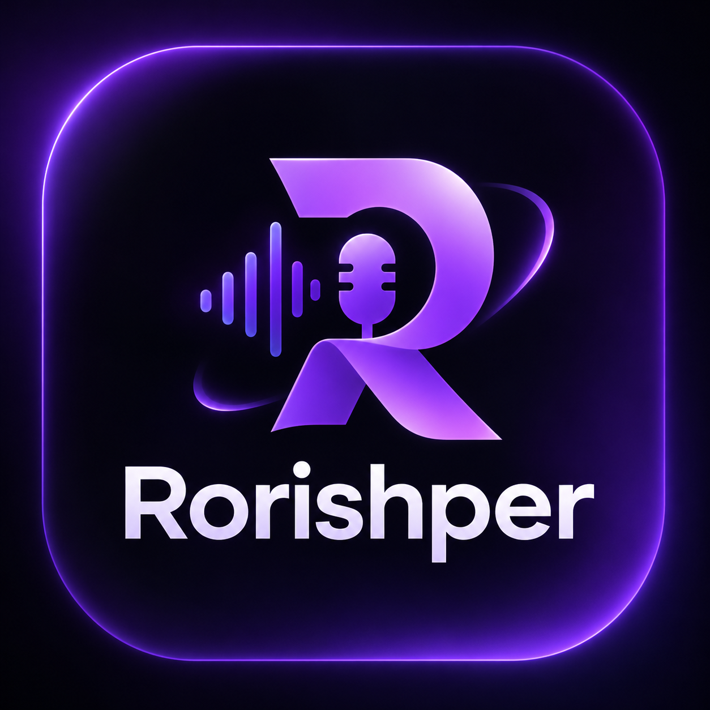

<p align="center">
  
</p>

# Rorishper

> Fast, private, local push-to-talk voice typing for Windows powered by NVIDIA GPU-accelerated [Faster-Whisper](https://github.com/SYSTRAN/faster-whisper).
> 
> Created by [Rohan Das](https://rohandas.is-a.dev/)

---

## Features

- **Push-to-Talk Voice Typing**: Hold your shortcut (Alt + Shift by default), speak naturally, and release. The transcribed text automatically pastes into your active application.
- **Midnight Black Design System**: Built with deep navy panels, electric purple glows, neon blue highlights, and cool white typography.
- **Customizable Animation Styles**: Choose your preferred visualizer directly in Preferences:
  - **Waveform (Audio-style)**: Multi-layered organic sine waves with dynamic microphone reactivity, soft lavender harmonic crests, and depth shading.
  - **Glowing Bars (Capsule)**: 9 rounded equalizer capsule bars with a smooth gradient from Neon Blue to Soft LaveOkayHow does it look?nder and audio bounce.
  - **Fluid Ribbon (Neon Wave)**: A continuous illuminated neon ribbon undulating smoothly between oscillating boundaries.
- **Floating Glass Indicator Pill**: A high-DPI, translucent indicator pill that floats at the bottom-center of your screen while speaking or transcribing. It features `WS_EX_NOACTIVATE` so it never steals focus from your active document or code editor.
- **Instant "Preview Pill" Button**: Test and preview the floating indicator and your selected animation style anytime with a single click in Preferences.
- **Scrollable Interface**: Smooth built-in vertical scrollbar ensures seamless access to all controls on screens and resolutions of any size.
- **100% Hardware Hotkey Reliability**: Uses direct Windows `GetAsyncKeyState` polling that never gets unhooked by Windows power management, even after hours of background idle.
- **Automatic GPU Memory Management**: Models run in high-speed `float16` on NVIDIA CUDA. After 5 minutes of inactivity, GPU memory is automatically freed to preserve VRAM for gaming or other workloads, waking up seamlessly when you next speak.
- **Multilingual Transcription**: Automatic language detection supporting English, Hindi, and multilingual decoding.
- **Custom Application Icon & Taskbar Identity**: Windows AppUserModelID registration and multi-resolution `.ico` integration replace default Python icons on launch, in the taskbar, and in Alt+Tab.
- **System Tray Resident**: Minimizes cleanly to the system tray with live state icons (Ready, Listening, Transcribing, Waking, Sleeping).

---

## Branding & Visual Assets

| Asset | File | Dimensions | Purpose |
| :--- | :--- | :--- | :--- |
| **Squircle Brand Tile** | `icons/logo.png` | 1254 x 1254 | Primary brand art, README banner, and splash visual |
| **Transparent Brand Mark** | `icons/transparent.png` | 1312 x 1199 | Alpha-transparent ribbon R and wordmark for composites |
| **Masked App Squircle** | `icons/logo_clean.png` | 1254 x 1254 | Anti-aliased transparent-corner squircle for desktop displays |
| **App Header Mark** | `icons/app_mark.png` | 128 x 128 | High-DPI brand mark displayed in the app navigation header |
| **Multi-Res Windows Icon** | `icons/app.ico` | 16 to 256 px | Multi-resolution icon for Windows taskbar, title bar, and shortcuts |

---

## Theme Palette: Midnight Black

| Surface | Color | Hex Code | Description |
| :--- | :--- | :--- | :--- |
| **Main Background** | Midnight Black | `#0A0C12` | App root window and system tray tile backing |
| **Component Background** | Deep Navy | `#151727` | Hero card, preferences container, transcript well, pill body |
| **Waveform Shadows** | Dark Purple | `#332B5D` | Wave depth shading, vertical hairline divider, borders |
| **Border & Glow** | Electric Purple | `#5842D2` | Outer neon glow, brand glyph, active UI switches |
| **Waveform Highlights**| Neon Blue | `#666BDF` | Primary wave crests, capsule bar gradients, left edge glow |
| **Waveform Accents** | Soft Lavender | `#AB7EE1` | Harmonic wave crests, top specular rim, shortcut labels |
| **Text & Icons** | Cool White | `#EAEAF0` | High-contrast Segoe UI typography and icon glyphs |

---

## Getting Started

### Prerequisites

- **OS**: Windows 10 or Windows 11 (64-bit)
- **Python**: Python 3.10 to 3.12 installed and added to `PATH`
- **GPU**: NVIDIA GPU (RTX / GTX) with CUDA support for optimal performance

### Installation & Launch

1. Double-click **`run.bat`**:
   - Automatically sets up a local Python virtual environment (`.venv`).
   - Installs all dependencies from `requirements.txt` (including `faster-whisper`, `customtkinter`, `pillow`, `sounddevice`, `pynput`, etc.).
   - Launches `app.py`.
2. On first run, the selected Whisper model (`large-v3-turbo` by default) is downloaded automatically from Hugging Face and cached locally.

Alternatively, run from a terminal:
```pwsh
# Activate virtual environment
.\.venv\Scripts\Activate.ps1

# Start Rorishper
python app.py
```

---

## How to Use

1. **Speak to Type**:
   - Hold your hotkey (Alt + Shift by default).
   - The floating indicator pill appears at the bottom of the screen with a live audio visualizer.
   - Speak your sentence, then release the keys.
   - The audio is transcribed locally on your NVIDIA GPU and pasted (`Ctrl+V`) into your active window.
2. **Change Animation Style**:
   - Open the main window and go to **PREFERENCES -> Animation Style**.
   - Select between `Waveform (Audio-style)`, `Glowing Bars (Capsule)`, or `Fluid Ribbon (Neon Wave)`.
   - Click **Preview Pill** to see the new animation in action.
3. **Change Shortcut**:
   - In the hero section of the main window, click **Change shortcut** (or click the shortcut pill).
   - Press your desired combination of keys together (e.g. Ctrl + Shift, Alt + Space, or any F-key), then release.
   - Press Esc to cancel.
4. **Change Whisper Model**:
   - In **PREFERENCES -> Model**, choose from `tiny`, `base`, `small`, `medium`, `large-v3-turbo`, or `large-v3`.
   - Click **Reload model** in the footer to initialize the new model.
5. **System Tray**:
   - Closing the window minimizes Rorishper to the Windows system tray.
   - Double-click the tray icon to restore the main window, or right-click for options.

---

## Configuration (settings.json)

Settings are saved automatically to `settings.json` in the application directory:

```json
{
  "hotkey": [
    "alt",
    "shift"
  ],
  "model": "large-v3-turbo",
  "animation_style": "Waveform (Audio-style)",
  "paste": true,
  "idle_unload": true,
  "show_overlay": true,
  "language": "auto"
}
```

| Key | Type | Default | Description |
| :--- | :--- | :--- | :--- |
| `hotkey` | list | `["alt", "shift"]` | Physical keys held to activate voice capture |
| `model` | string | `"large-v3-turbo"` | Whisper model name (`tiny`, `base`, `small`, `medium`, `large-v3-turbo`, `large-v3`) |
| `animation_style` | string | `"Waveform (Audio-style)"` | Visualizer style (`Waveform (Audio-style)`, `Glowing Bars (Capsule)`, `Fluid Ribbon (Neon Wave)`) |
| `paste` | boolean | `true` | Automatically paste text via `Ctrl+V` into active app upon release |
| `idle_unload` | boolean | `true` | Release GPU VRAM after 5 minutes of idle inactivity |
| `show_overlay` | boolean | `true` | Show the floating bottom glass indicator pill while speaking |
| `language` | string | `"auto"` | Transcription language mode (`auto` detects English & Hindi) |

---

## Privacy & Architecture

- **100% Local**: Voice capture and transcription run entirely on your local machine using faster-whisper (CTranslate2). No audio, transcripts, or personal data are ever uploaded to any cloud server.
- **Zero-Drop Hardware Hotkeys**: Uses Windows native `GetAsyncKeyState` hardware state polling in a dedicated background worker, immune to OS hook timeouts or background suppression.
- **Focus Preservation**: The floating pill utilizes `WS_EX_NOACTIVATE` so typing focus in your target editor is never interrupted.
- **Optimized Compute**: Leverages CUDA 12 runtime wheel libraries and cuBLAS warmup to ensure near-instant first-token response times.

---

## Author

- Website: [https://rohandas.is-a.dev/](https://rohandas.is-a.dev/)
